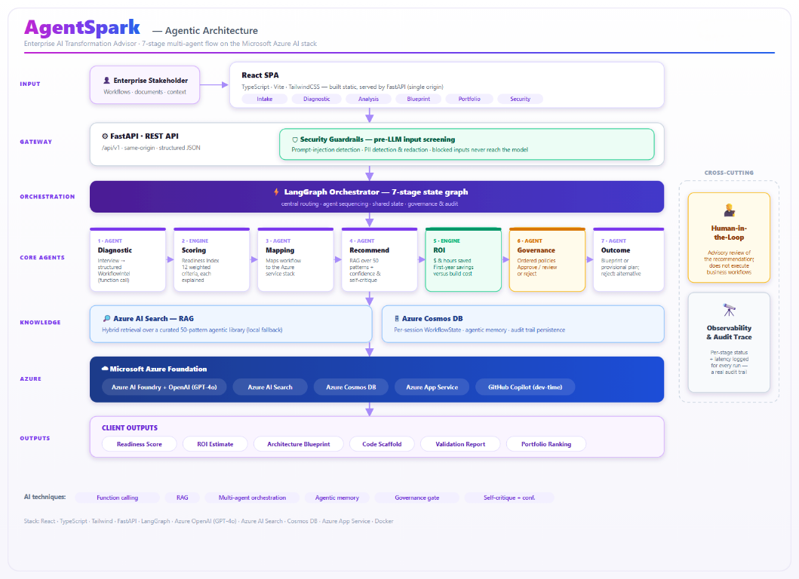

# AgentSpark

**The agent that tells you where agents belong.**

AgentSpark combines **SME AI consulting with an evidence-led assessment platform**.
It helps teams decide whether, where, and how to use AI agents, turning discovery
and workflow interviews into scored assessments, cloud-specific architecture
recommendations, an illustrative business case, and a reviewable blueprint.

## Public website delivery

`npm --prefix frontend run build` builds the interactive client and pre-renders
all public routes from the same React components and route definitions. The initial
HTTP response contains the real page content, links, design styles and page-specific
titles, descriptions and social preview metadata, without requiring JavaScript.
Home is titled **AgentSpark | AI Consulting & Assessment for SMEs**. Canonical
paths resolve against the serving origin, without assuming a production domain.

This is build-time HTML generation followed by a client mount, not runtime SSR
or hydration. The public document stays readable while its interactive component
loads. Consultation calls to action are ordinary Cal.com links that work without
JavaScript and preserve modified-click/new-tab behavior. With JavaScript, an
ordinary click opens the existing opt-in booking dialog instead. Sign-in,
assessment tools, interactive previews and appearance preferences require
JavaScript; the static page explains this and offers direct public navigation.
Public pages have a dedicated client entry that completes their interactive mount
before `DOMContentLoaded`, while the private entry retains lazy public-site loading.
No private records, user identity or consulting-calendar requests enter the build.
The public website leads with practical SME consulting and consultation booking.
Technical detail and secondary audiences remain on dedicated pages. Four concise
navigation groups lead to a smaller set of entry points; overview pages and the
footer keep the full public content reachable. On Home, only the five-stage product
walkthrough uses numbered stages. Privacy/terms publication, a contact email and
a custom domain require separately approved business and legal details.
Without JavaScript the static appearance is Dark. A small same-origin blocking
script applies the saved browser preference before public content is painted,
using the same preference validation and theme logic as the interactive provider.

FastAPI serves the generated public documents with no-store HTML headers.
The private workspace uses a separate empty client shell with `noindex,nofollow`;
the same metadata is maintained on client navigation. Missing pages return HTTP
404 and remain non-indexable. Existing API authentication and path-containment
checks remain in force; robots metadata is not an access-control mechanism.
No Node runtime or browser is needed in the Python production container.

## Architecture

[View the full-size diagram](docs/agentspark-architecture.png). This is a conceptual
overview, not an as-deployed specification: current retrieval is keyword-based,
and the diagram's model/hosting labels are illustrative. Current configuration is covered in the
[assessment reference](docs/assessment-reference.md) and [operations runbook](docs/operations.md).

## What you can do

- **Choose a consistent appearance:** public pages, Home, Discovery, assessments
  and team areas share rounded surfaces, local typography and lavender accents.
  Choose Dark, Light or System using Appearance in the public header or workspace
  toolbar. The non-sensitive preference is saved in this browser, follows you
  between routes and synchronizes between tabs. System follows changes to the OS
  color scheme; explicit choices take precedence. Dark is the initial default.
  Storage failures are reported explicitly and do not block access or workflows.
  No identity or customer data is saved with the appearance preference. Violet
  replaces green accents and positive score/status fills; explicit status labels
  and amber/red warning states remain. The responsive shell retains visible
  keyboard focus, readable forms and existing workflow, permission and data behavior.
- **Start business-first discovery:** create a scoped engagement with an objective,
  sponsor, business units, topics and dates; save manual role contributions,
  candidate opportunities and links to existing assessments.
- **Guide the engagement from scope to findings:** choose AI-native readiness or
  Workflow opportunity discovery, record facilitator answers with explicit unknowns,
  and use the engagement overview to find missing perspectives, overdue requests,
  evidence issues and next actions. Section shortcuts preserve unsaved editors.
  Export a standalone, version-scoped findings PDF without creating an assessment.
  Record a human conclusion, including process improvement, conventional automation,
  more evidence or do not proceed. Activity checks are not AI-readiness scores;
  provider advice does not provision accounts. See [guided discovery](docs/discovery-processes.md#guided-discovery-engagements).
- **Build a stakeholder-backed opportunity shortlist:** assign active team members
  their own structured contributions, generate source-linked hypotheses using an
  approved model, and rank opportunities using explicit weighted assumptions.
  Review a selected opportunity into an assessment without confirming its claims.
- **Collaborate around a process:** create process cards with owners, steps,
  systems, goals and baselines. Request process/step-specific input from active
  signed-in team members, with due dates and visible submission/clarification status.
  People retain their own drafts; submitted sources inform synthesis and selected
  opportunities. Review evidence and resolve clarifications without automatically
  confirming assessment facts. Compare unchanged work, process improvement,
  deterministic automation, AI assistance and hybrid options using explicit rationales.
  Source edits stale reviews, synthesis and ratings; reviewed handoffs and report
  exports retain frozen process provenance. Legacy engagements retain their existing
  source digest and fixed retention. See [process collaboration](docs/discovery-processes.md).
- **Interview by role:** business operators, process owners and technical owners
  receive their assigned questions. Unconfirmed answers remain unresolved; role
  completion never bypasses the full assessment's evidence requirements.
- **Make an executive decision:** inspect a source-linked executive brief with
  an advisory decision, illustrative capacity value, gaps and next action.
  Export Markdown or a one-page PDF without confusing suitability with pilot readiness.
- **Explore before signing in:** the public homepage links to focused
  Consulting, About, Platform, Solutions and Resources pages. Each submenu has a dedicated URL,
  page title and active-navigation state; direct links, refresh and browser history
  work without discarding a restored assessment. The public experience uses an
  original process-to-opportunity hero, a visitor-controlled five-stage product
  reconstruction, illustrated product/solution pages and grouped visual menus.
  Discover, Align, Prioritize, Prepare and Decide previews are fictional and make no
  model calls or saved records. Keyboard tabs, finite entry motion and reduced-motion
  settings keep the experience accessible. The premium redesign replaces
  the previous 2000px homepage limit with six bounded sections and a 4800px desktop
  ceiling, making room for product evidence without copying a long competitor page.
  The visual palette keeps violet for primary actions, deep navy for product panels,
  teal for process/evidence accents and restrained amber for unresolved validation
  cues. Color is decorative or supplementary; explicit labels carry status.
  The shared discovery invitation illustrates question, team insights, evidence and
  a human-reviewed next step. Its background and stage highlights play once on entry
  and settle within five seconds; keyboard-accessible replay is optional. Small
  mobile screens and reduced-motion settings use a static illustration.
  The Solutions overview's AI readiness and Process intelligence cards explain data,
  ownership and pilot gaps alongside process steps and improvement alternatives.
  Both remain visible without autoplay and use clearly fictional previews, not
  measured customer results, organizational monitoring or process-mining claims.
  The homepage presents AgentSpark Consulting alongside the existing evidence-led
  assessment platform. Consulting is separately scoped human delivery, not a new
  automated provider integration or a change to the signed-in product.
  The public site uses an original consultancy-first editorial identity: large
  typography, a graphite/white palette with violet accents, numbered delivery
  chapters and a decorative SVG journey. Desktop and mobile both offer continuous
  motion with a pause/resume control; small screens use a complete vertical
  diagram rather than a cropped desktop canvas. Reduced-motion preferences keep
  the illustration static. No scroll hijacking or third-party motion assets.
  The approved visual design adds a centered hero, rounded evidence panels and
  consulting bento cards, with a near-black/lavender theme and a complementary
  warm light theme. The accessible Appearance control shares a browser-saved
  preference across the public site and signed-in workspace. All existing copy, real links,
  five manual product stages and opt-in booking remain intact. Fonts are served
  locally with their SIL Open Font License notices in `frontend/public/fonts/OFL.txt`.
  The same design tokens cover navigation, forms, cards, tables, dialogs,
  discovery, assessments, teams and organization settings. Warning/error labels
  and business permissions are unchanged; appearance never changes saved facts,
  consensus, authorization, AI processing or generated report content.
  The homepage product walkthrough lets visitors select fictional reported
  friction and inspect source statements and an advisory next step. It makes no
  model calls, writes, measured-outcome claims or changes to customer systems.
  The global booking action is independent of workspace authentication; protected
  discovery remains available through explicit platform actions.
  `/consulting` explains the AI-native approach and four offerings:
  `/consulting/readiness`, `/consulting/workspace-launch`,
  `/consulting/workflow-pilot` and `/consulting/adoption`. Each has its own outputs,
  delivery method, customer responsibilities and explicit exclusions.
  OpenAI, Anthropic and Google are independent advisory options, not partner claims;
  workplace subscriptions and developer workloads are separate. Google consulting
  does not add Google Cloud blueprint generation to the platform's Azure/AWS support.
  Leadership/investment/programme-review content emphasizes baseline evidence,
  repeatable delivery and customer capability without promising funding, grant
  eligibility, EU endorsement or blanket GDPR/AI Act certification.
  Consulting calls use the supplied
  [Cal.com event](https://cal.com/vienna-now-rdnzte/agentspark-consulting).
  “Book a consultation” opens an accessible first-party dialog. The official
  Cal.com embed library and third-party calendar load only after “Open calendar”;
  a direct booking link remains available when the embed is blocked or slow.
  Loading failures or the 20-second readiness timeout hide the stalled embed and
  show an adjacent “Open booking page” action, rather than an endless spinner or
  a reference to an offscreen link. A late successful load restores the calendar.
  VS Code's integrated browser may stall cross-origin frames even when the
  calendar works in a standalone browser; the direct booking page is independent
  of embedding and remains a supported path.
  The dialog discloses Cal.com's scheduling-data processing and privacy policy.
  Query forwarding is explicitly disabled, links suppress the referrer, and no
  assessment data or secrets are prefilled. Assistant booking is a separate
  clipboard action with visible success/error feedback and manual-copy fallback.
  Visitors paste the supplied MCP/event instructions into their own compatible
  assistant, review permissions and confirm details. Copying never books or
  connects anything. Signed-in platform discovery remains a distinct action;
  no booking records or contact details are stored in the AgentSpark workspace.
  Technology panels separate available platform capabilities, Azure/AWS blueprint
  candidates and customer implementation responsibilities. User-supplied, approved
  Azure/AWS SVG assets accompany the cloud labels with their original colors and
  proportions; they do not imply connected integrations or vendor endorsements.
  The assets are bundled locally with no third-party image requests.
  The workflow-review call to action uses
  existing authenticated discovery, not an unimplemented booking/contact service.
  Platform pages show the fictional discovery walkthrough and explicit source/rating
  limitations. `/resources/example-assessment` preserves the claims, invoice and
  onboarding explorer, readiness gaps, capacity assumptions and Azure/AWS candidates.
  `/platform`, `/solutions` and `/resources` provide browsable overview pages.
  The focused homepage leads with the new capabilities and product walkthrough;
  the earlier detailed readiness/process examples now live in Solutions instead
  of extending the homepage.
  The homepage capability cards and product walkthrough surface stakeholder
  alignment, concise outcome-led decisions, connected visual blueprints and Home
  organization/team selection. `/platform/alignment` distinguishes nominations
  from signed-in acceptance and silence from agreement; `/platform/workspaces`
  explains scoped libraries, permissions and the five-minute per-tab idle policy,
  including draft/active-work delays. Solutions pages connect an illustrative
  business problem to reviewable outputs. The Resources collection links to
  examples, supported capabilities, trust boundaries and a five-question decision
  review guide; it does not claim downloadable files or customer results that do
  not exist. Every preview is fictional and read-only. Existing consulting entry,
  opt-in scheduling, authenticated discovery and private workspace behavior remain.
  `/platform/architecture` includes a fictional invoice-assistance diagram that
  separates inputs, AI suggestions, human approval and authorized business actions.
  It distinguishes AgentSpark's advisory blueprint from integrations, controls
  and deployment that a customer delivery team must implement and validate.
  Public previews make no model calls and create no records. **Start discovery**
  opens discovery engagements through organization access in live mode, preserving
  the selected destination after sign-in and any restored assessment.
  **Assess my workflow** still opens intake; **Workspace** opens your library.
  **Product overview** returns without discarding active work. This redesign does
  not change the signed-in workspace or imply deployment or pilot readiness.
  `/workspace` is the private entry boundary; legacy root assessment restoration
  remains supported. Browser Back and overview actions protect unsaved discovery.
  Home library keyboard navigation preserves selected-tab focus during loading;
  tabs and creation actions remain unavailable until the current operation settles.
  Unknown public URLs show a clear not-found page; unknown `/api` paths remain
  JSON 404 responses rather than being rewritten to the public website.
- **Assess a workflow:** use up to 10 grouped interview rounds for suitability and
  draft readiness, then finish missing answers in an editable checklist.
- **Select the assessment model before interviewing:** choose an administrator-enabled
  Azure OpenAI or Anthropic-on-Azure-Foundry connection at intake. One model is pinned
  per assessment after generation begins; no provider fallback is used. Saved state,
  archived decisions and PDFs retain the model identity. Historical records without
  provenance are labelled as such; demo fixtures never call either provider.
- **Choose Azure or AWS:** receive service candidates and a blueprint for the
  proposed customer solution. AgentSpark itself remains Azure-hosted.
- **Choose the execution architecture:** capture runtime requirements and inspect
  separate reasoning and durable-execution recommendations: application code,
  bounded AI, LangGraph, Temporal, Azure Durable Functions or AWS Step Functions.
  Versioned rules explain alternatives, trade-offs and unresolved validation needs;
  no framework is deployed or assumed to fit automatically.
- **Inspect the recommendation:** review the 12-criteria readiness score, grounded
  patterns, estimated ROI scenarios, and policy outcome.
- **Record evidence:** distinguish client statements, source-supported findings,
  assumptions, and open questions; record reviewer attestations and validation needs.
- **Assess delivery readiness:** identify integration, data, security, oversight,
  cloud and operational blockers; record owners and pilot entry criteria separately
  from agent suitability.
- **Collaborate:** use organization/team workspaces, invite links, and independent
  creator/reviewer approval.
- **Retain decisions:** export Markdown blueprints and inspect archived decisions
  with the evidence and deployment preferences reviewed at the time.
- **Download a PDF report:** use **Export PDF** in Blueprint & Review for the current
  assessment, including evidence, implementation readiness, ROI and approval status.

**Flow:** Optional discovery engagement -> Intake -> Role-based diagnostic interview -> Evidence & assumptions -> Analysis ->
Blueprint & review -> Decision archive.

Discovery notes are workspace-visible, not anonymous or verified evidence.
New engagements expire 30 days after creation; reads and ordinary edits never
extend that period. Authorized explicit renewal starts another 30 days. Legacy
engagements keep their old expiry until renewed. Participation uses existing
signed-in organization/team invitations, not anonymous or external access links.
Draft responses are excluded from synthesis; source changes mark snapshots stale.
Unknown ratings withhold priority scores. Reviewed handoffs copy unverified
provenance, not confirmed facts, and retain ordinary assessment/decision expiry.

## Run locally

Requires **Python 3.12** and **Node.js 24**. From the repository root, with a Python
virtual environment active:

```powershell
Copy-Item .env.example .env
python -m pip install --only-binary=:all: --require-hashes -r requirements.lock
npm --prefix frontend ci
npm --prefix frontend run build
python -m uvicorn app.main:app --host 127.0.0.1 --port 8000
```

Open **http://localhost:8000**. Local development defaults to deterministic demo
mode; select a named fictional sample to exercise the complete workflow.
Demo is shared and unauthenticated: use fictional data and do not expose it publicly.

Alternatively, with Docker Compose v2.24+:

```powershell
docker compose up --build agentspark
```

For live Azure dependencies, Microsoft sign-in, frontend hot reload, and deployment,
follow the [operations runbook](docs/operations.md). Live mode requires explicit
configuration and does not silently fall back to demo.

## Validate changes

```powershell
python -m pip install -r requirements-tools.txt
python scripts/check.py
npm --prefix frontend run test:e2e
```

The checks cover backend regressions, the offline workflow scenario, scoring
evaluations, dependency consistency, frontend types/build, and browser workflows.
Browser checks require Playwright Chromium and WebKit (mobile journey and portal design regressions); see the
[toolchain and setup instructions](docs/operations.md#supported-toolchain-and-repeatable-checks).
[GitHub CI](.github/workflows/ci.yml) also builds and smoke-tests a non-root container.
CI does **not** deploy automatically.

## Important boundaries

- Approval is advisory: AgentSpark does not deploy a customer solution or execute
  business actions such as releasing payments.
- AWS selection changes the assessment target, not where AgentSpark processes data.
  Cloud availability, residency, model access, and prices require validation.
- Evidence references and reviewer attestations are not automated verification.
  Document uploads are not part of the current evidence register.
- ROI scenarios are assumption-based estimates, not guaranteed cash savings.
  Generated scaffolds are illustrative, untested, and not deployment-ready.
- Evidence/input changes invalidate current analysis and approval; previous archived
  decisions remain unchanged. Access, retention, and deletion rules still apply.
- Legacy `AGENTSENSE_*` settings, `AgentSense.Reviewer`, database/storage names, and
  browser identifiers remain intentionally compatible.

## Documentation

- [Document-assisted intake](docs/document-assisted-intake.md): PDF/DOCX review,
  human approval, missing-question/blueprint continuation and live processing stages.
- [Assessment reference](docs/assessment-reference.md): scoring, grounding, evidence,
  governance, API contracts, permissions, and compatibility.
- [Operations runbook](docs/operations.md): configuration, delivery, security
  boundaries, retention, release checks, and rollback.

## Maintainer and attribution

**Muntazir Abbas** maintains and develops AgentSpark.

The base work was forked from
[AgentSense by Shriram K Vasudevan](https://github.com/shriramkv/The-AgentSense).
AgentSpark builds on that foundation; original commit history and contributor
credits are retained. Development uses AI coding assistance, with human review
and automated validation.
