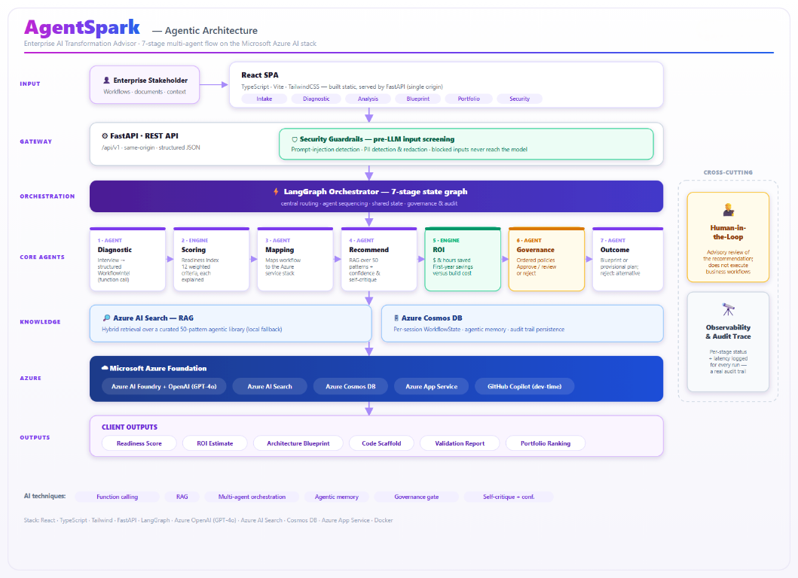

# AgentSpark

**The agent that tells you where agents belong.**

AgentSpark helps enterprises decide **whether, where, and how to use AI agents**.
It turns a workflow interview into a scored assessment, cloud-specific architecture
recommendations, an estimated business case, and a reviewable blueprint.

## Architecture

[View the full-size diagram](docs/agentspark-architecture.png). This is a conceptual
overview, not an as-deployed specification: current retrieval is keyword-based,
and the diagram's model/hosting labels are illustrative. Current configuration is covered in the
[assessment reference](docs/assessment-reference.md) and [operations runbook](docs/operations.md).

## What you can do

- **Assess a workflow:** capture its systems, volume, exceptions, decisions, and risks.
- **Choose Azure or AWS:** receive service candidates and a blueprint for the
  proposed customer solution. AgentSpark itself remains Azure-hosted.
- **Inspect the recommendation:** review the 12-criteria readiness score, grounded
  patterns, estimated ROI scenarios, and policy outcome.
- **Record evidence:** distinguish client statements, source-supported findings,
  assumptions, and open questions; record reviewer attestations and validation needs.
- **Assess delivery readiness:** identify integration, data, security, oversight,
  cloud and operational blockers; record owners and pilot entry criteria separately
  from agent suitability.
- **Collaborate:** use organization/team workspaces, invite links, and independent
  creator/reviewer approval.
- **Retain decisions:** export Markdown blueprints and inspect archived decisions
  with the evidence and deployment preferences reviewed at the time.

**Flow:** Intake -> Diagnostic interview -> Evidence & assumptions -> Analysis ->
Blueprint & review -> Decision archive.

## Run locally

Requires **Python 3.12** and **Node.js 24**. From the repository root, with a Python
virtual environment active:

```powershell
Copy-Item .env.example .env
python -m pip install --only-binary=:all: --require-hashes -r requirements.lock
npm --prefix frontend ci
npm --prefix frontend run build
python -m uvicorn app.main:app --host 127.0.0.1 --port 8000
```

Open **http://localhost:8000**. Local development defaults to deterministic demo
mode; select a named fictional sample to exercise the complete workflow.
Demo is shared and unauthenticated: use fictional data and do not expose it publicly.

Alternatively, with Docker Compose v2.24+:

```powershell
docker compose up --build agentspark
```

For live Azure dependencies, Microsoft sign-in, frontend hot reload, and deployment,
follow the [operations runbook](docs/operations.md). Live mode requires explicit
configuration and does not silently fall back to demo.

## Validate changes

```powershell
python scripts/check.py
npm --prefix frontend run test:e2e
```

The checks cover backend regressions, the offline workflow scenario, scoring
evaluations, dependency consistency, frontend types/build, and browser workflows.
Browser checks require Playwright Chromium; see the
[toolchain and setup instructions](docs/operations.md#supported-toolchain-and-repeatable-checks).
[GitHub CI](.github/workflows/ci.yml) also builds and smoke-tests a non-root container.
CI does **not** deploy automatically.

## Important boundaries

- Approval is advisory: AgentSpark does not deploy a customer solution or execute
  business actions such as releasing payments.
- AWS selection changes the assessment target, not where AgentSpark processes data.
  Cloud availability, residency, model access, and prices require validation.
- Evidence references and reviewer attestations are not automated verification.
  Document uploads are not part of the current evidence register.
- ROI scenarios are assumption-based estimates, not guaranteed cash savings.
  Generated scaffolds are illustrative, untested, and not deployment-ready.
- Evidence/input changes invalidate current analysis and approval; previous archived
  decisions remain unchanged. Access, retention, and deletion rules still apply.
- Legacy `AGENTSENSE_*` settings, `AgentSense.Reviewer`, database/storage names, and
  browser identifiers remain intentionally compatible.

## Documentation

- [Assessment reference](docs/assessment-reference.md): scoring, grounding, evidence,
  governance, API contracts, permissions, and compatibility.
- [Operations runbook](docs/operations.md): configuration, delivery, security
  boundaries, retention, release checks, and rollback.

## Maintainer and attribution

**Muntazir Abbas** maintains and develops AgentSpark.

The base work was forked from
[AgentSense by Shriram K Vasudevan](https://github.com/shriramkv/The-AgentSense).
AgentSpark builds on that foundation; original commit history and contributor
credits are retained. Development uses AI coding assistance, with human review
and automated validation.
